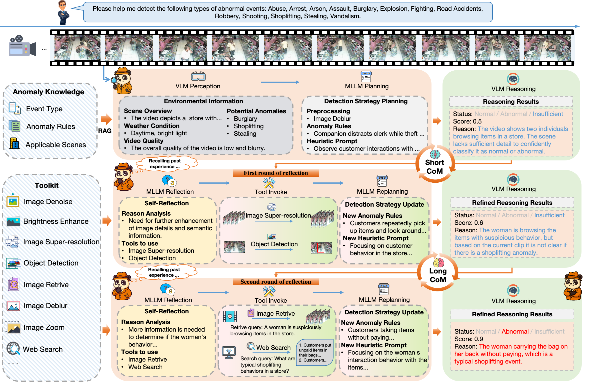

# PANDA: Towards Generalist Video Anomaly Detection via Agentic AI Engineer

<!-- <div align="center">
  
</div> -->
**Zhiwei Yang, Chen Gao, Mike Zheng Shou**  

[**NeurIPS 2025**] Accepted Paper  

---

## 🔍 Overview

Video anomaly detection (VAD) is a critical yet challenging task due to the **complex and diverse nature of real-world scenarios**. Existing approaches usually require **domain-specific training data** and heavy manual tuning, making them costly and less generalizable to unseen anomaly types or environments.  

We present **PANDA**, an **agentic AI engineer** built on MLLMs (multimodal large language models), designed to achieve **generalist video anomaly detection**—handling **any scene and anomaly type automatically, without additional training or human intervention**.  

---

## 🚀 Key Contributions

PANDA introduces **four major capabilities** to realize training-free, generalist VAD:

1. **Self-adaptive scene-aware strategy planning**  
   - A RAG-based mechanism retrieves anomaly-specific knowledge for tailored detection strategies.

2. **Goal-driven heuristic reasoning**  
   - Latent anomaly-guided prompts refine reasoning precision.

3. **Tool-augmented self-reflection**  
   - Progressive reflection with tools (e.g., super-resolution, object detection, retrieval, web search) improves decision-making.

4. **Self-improving chain-of-memory (CoM)**  
   - Leverages past experiences for continual performance enhancement across diverse scenarios.

---

## 🧩 System Framework

<div align="center">
  
</div>

- **Perception**: VLM extracts environmental and video-specific cues.  
- **Planning**: MLLM designs anomaly detection strategies via rules + heuristic prompts.  
- **Reflection**: Iterative tool invocation (e.g., super-resolution, retrieval, web search) enhances analysis.  
- **Chain-of-Memory**: Past reasoning and decisions are recalled to guide future anomaly detection.  

---

## 🔥 Updates
- [09/2025] Repo initialized.  
- The implementation, rule banks, and evaluation scripts are included in this repository.

---

## Installation

Use Python 3.10 or newer. A CUDA-capable GPU is recommended for the Qwen visual
model and model-backed image tools. Model serving and the PANDA client can run
in separate environments or on separate machines.

```bash
git clone https://github.com/showlab/PANDA.git
cd PANDA
python -m venv .venv
source .venv/bin/activate
python -m pip install --upgrade pip
python -m pip install -e ".[agents,rag,video,eval]"
```

For object detection, CLIP retrieval, and Real-ESRGAN reflection, install the
vision dependencies after installing a PyTorch build appropriate for your device:

```bash
bash scripts/install_vision_tools.sh
```

The installer targets inference. It installs stable TensorBoard explicitly and
bypasses BasicSR/GFPGAN's upstream `tb-nightly` training metadata; `pip check`
can therefore report that training-only requirement. PANDA's super-resolution
loader supplies the compatible Torchvision grayscale import for BasicSR.

See the [PyTorch installation selector](https://pytorch.org/get-started/locally/)
for CUDA-specific wheels. The client accesses the visual model through an
OpenAI-compatible endpoint; it does not require vLLM in the client environment.

## Repository Layout

```text
PANDA/
├── panda/
│   ├── agents/              # Perception, planning, analysis, and reflection
│   ├── graph/               # Agent workflow
│   ├── evaluation/          # Annotation readers, metrics, and result merging
│   ├── rag/rules/           # Rule JSON files, FAISS indexes, and asset manifest
│   ├── tools/               # Image, retrieval, and web tools
│   └── resources/           # Endpoint configuration
├── scripts/                # Model serving, asset manifests, and evaluation
├── data/annotations/       # UCF, XD, UB, and CSAD video annotations
├── assets/                 # Framework figures
├── .env.example
└── pyproject.toml
```

## Model and Service Configuration

### 1. Download model assets

The rule banks and FAISS indexes are included. Pretrained model weights and
benchmark videos are downloaded separately from their providers.

```bash
mkdir -p models/clip manifests
hf download Qwen/Qwen2.5-VL-7B-Instruct --local-dir models/Qwen2.5-VL-7B-Instruct
hf download sentence-transformers/all-MiniLM-L6-v2 --revision 1110a243fdf4706b3f48f1d95db1a4f5529b4d41 --local-dir models/all-MiniLM-L6-v2 --include '*.json' '1_Pooling/*' model.safetensors vocab.txt
hf download openai/clip-vit-base-patch32 --revision 3d74acf9a28c67741b2f4f2ea7635f0aaf6f0268 --local-dir models/clip-vit-base-patch32 --include '*.json' merges.txt pytorch_model.bin
curl --fail -L https://github.com/ultralytics/assets/releases/download/v8.3.0/yolov8l-worldv2.pt -o models/yolov8l-worldv2.pt
curl --fail -L https://github.com/xinntao/Real-ESRGAN/releases/download/v0.1.0/RealESRGAN_x4plus.pth -o models/RealESRGAN_x4plus.pth
curl --fail -L https://openaipublic.azureedge.net/clip/models/40d365715913c9da98579312b702a82c18be219cc2a73407c4526f58eba950af/ViT-B-32.pt -o models/clip/ViT-B-32.pt
```

The `hf` command is provided by `huggingface_hub`. Keep the complete Hugging Face
model directories, including tokenizer and processor files.

YOLOWorld uses the additional OpenAI `ViT-B-32.pt` text encoder, independently of
the Hugging Face CLIP directory used by frame retrieval. Configure its cache in
a preparation process before starting the inference process:

```bash
export YOLO_CONFIG_DIR="$PWD/.local/ultralytics"
python -c 'from pathlib import Path; from ultralytics.utils import SETTINGS; SETTINGS.update({"weights_dir": str(Path("models").resolve()), "sync": False})'
```

Use the same `YOLO_CONFIG_DIR` in subsequent runs. Ultralytics reads this cache
location during import; changing it after importing the model is too late.

| Component | Model or implementation |
|---|---|
| Perception and analysis | Qwen2.5-VL-7B-Instruct |
| Planning and reflection | Gemini or an OpenAI-compatible text-generation endpoint |
| Rule retrieval and long memory | all-MiniLM-L6-v2 |
| Object detection | YOLOWorld, `yolov8l-worldv2.pt` |
| Historical-frame retrieval | CLIP ViT-B/32 |
| Super-resolution | RealESRGAN x4plus |
| Denoising / deblurring / brightness / zoom | OpenCV |
| Web search | Tavily |

### 2. Start the visual-model server

Install [vLLM](https://docs.vllm.ai/en/latest/getting_started/installation/) in a
serving environment. Start Qwen with the provided launcher:

```bash
MODEL_PATH=/absolute/path/to/models/Qwen2.5-VL-7B-Instruct \
CUDA_VISIBLE_DEVICES=0 PORT=8000 bash scripts/start_vllm.sh
```

Use `TENSOR_PARALLEL_SIZE` to serve across multiple GPUs. The endpoint must
support image inputs and native video-frame sequences with explicit FPS.

### 3. Configure the client

```bash
cp .env.example .env
```

Edit `.env` to specify the visual endpoint, planning/reflection provider,
local model paths, and service keys. For Gemini, set `GEMINI_MODEL` to a model
available in your account and set `GEMINI_API_KEY`. For an OpenAI-compatible
planning/reflection service, configure `PLANNER_PROVIDER=openai`,
`PLANNER_BASE_URL`, `PLANNER_MODEL`, and `PLANNER_API_KEY`; reflection can inherit
those settings or use its own `REFLECTION_*` values. Use `TAVILY_API_KEY` for
the web-search tool. Never commit a populated `.env` file.

Both visual roles use the configured `VLM_MODEL_PATH` or the selected endpoint's
model identifier. Pass `--allow-model-substitution` when choosing a different
model or provider for a fixed protocol. Model selections are recorded with
results so runs using different configurations cannot be combined accidentally.

### 4. Generate content manifests

Set the following variables in the shell used to launch PANDA. The directory
manifests bind model files to their configured content digests; file-based tool
weights use their SHA-256 digests.

```bash
set -a
source .env
set +a

export PANDA_RULES_DIR="$PWD/panda/rag/rules"
export VLM_MODEL_PATH="$PWD/models/Qwen2.5-VL-7B-Instruct"
export EMBEDDING_MODEL_PATH="$PWD/models/all-MiniLM-L6-v2"
export PANDA_CLIP_MODEL_PATH="$PWD/models/clip-vit-base-patch32"
export PANDA_YOLO_MODEL_PATH="$PWD/models/yolov8l-worldv2.pt"
export PANDA_SR_MODEL_PATH="$PWD/models/RealESRGAN_x4plus.pth"
export VLM_MODEL_MANIFEST="$PWD/manifests/vlm.json"
export EMBEDDING_MODEL_MANIFEST="$PWD/manifests/embedding.json"

export VLM_MODEL_SHA256="$(python scripts/build_content_manifest.py --root "$VLM_MODEL_PATH" --output "$VLM_MODEL_MANIFEST" --model-id Qwen2.5-VL-7B-Instruct)"
export EMBEDDING_MODEL_SHA256="$(python scripts/build_content_manifest.py --root "$EMBEDDING_MODEL_PATH" --output "$EMBEDDING_MODEL_MANIFEST" --model-id all-MiniLM-L6-v2)"
export PANDA_CLIP_MODEL_SHA256="$(python scripts/build_content_manifest.py --root "$PANDA_CLIP_MODEL_PATH" --output "$PWD/manifests/clip.json" --model-id clip-vit-base-patch32)"
export PANDA_YOLO_MODEL_SHA256="$(python -c 'import hashlib,os; print(hashlib.sha256(open(os.environ["PANDA_YOLO_MODEL_PATH"],"rb").read()).hexdigest())')"
export PANDA_SR_MODEL_SHA256="$(python -c 'import hashlib,os; print(hashlib.sha256(open(os.environ["PANDA_SR_MODEL_PATH"],"rb").read()).hexdigest())')"
```

Manifest files must be outside their model directories. Configure all three
model-backed tools for the fixed offline/online profiles, since reflection may
select any of them. API credentials are not written into model manifests.

## Run PANDA on a Video

```bash
panda \
  --video /path/to/video.mp4 \
  --dataset ucf \
  --query "Detect abnormal events in this video." \
  --profile paper-offline \
  --allow-model-substitution \
  --output-dir results/video
```

The JSON output contains window-level status, anomaly score, reasoning, tool
information, and the memory trajectory. A non-finite score, malformed provider
response, or failed tool is reported as an execution failure rather than a
normal detection. Configure planning/reflection providers through `.env` or
explicit `--planning-provider` and `--reflection-provider` arguments.

| Profile | Perception | Analysis | Memory and reflection |
|---|---|---|---|
| `paper-offline` | Up to 300 uniformly sampled frames | 1 FPS; five-frame windows | Per-video long memory; five-window short memory; up to three reflections |
| `paper-online` | Initial ten sampled frames | 1 FPS; five-frame windows | Past-window context; up to three reflections |
| `engineering` | Configurable | Configurable | Configurable retrieval and memory |

The online profile performs initial scene calibration before producing the
first window scores. It does not apply the offline score-smoothing step.

## Datasets and Annotations

Download videos under the terms of the original providers and arrange them so
annotation filenames resolve beneath the selected video root.

| Dataset | Annotation file | Videos | Provider |
|---|---|---:|---|
| UCF-Crime | `data/annotations/ucf.txt` | 290 | [UCF-Crime](https://www.crcv.ucf.edu/projects/real-world/) |
| XD-Violence | `data/annotations/xd.txt` | 800 | [XD-Violence](https://roc-ng.github.io/XD-Violence/) |
| UBnormal | `data/annotations/ub.txt` | 211 | [UBnormal](https://github.com/lilygeorgescu/UBnormal) |
| CSAD | `data/annotations/csad.txt` | 100 | Selected complex-scene videos from UCF-Crime, XD-Violence, and UBnormal |

CSAD includes 50 normal and 50 abnormal videos. The included annotation file
specifies its video list. Match the filenames, including any degraded-video
suffixes, when preparing the CSAD video directory.

UCF annotations use:

```text
filename class start_frame end_frame [start_frame end_frame ...]
```

XD, UB, and CSAD annotations use:

```text
filename start_frame end_frame [start_frame end_frame ...]
```

Endpoints are inclusive original-frame indices. `-1 -1` denotes no anomaly.
Names without a video extension are resolved with `.mp4` when present. Dataset
videos and annotations retain their respective dataset terms; the repository's
code license does not replace those terms.

## Dataset Evaluation

Run one dataset shard, then merge the complete run to compute the final metric:

```bash
panda-eval \
  --profile paper-offline \
  --allow-model-substitution \
  --dataset ucf \
  --video-root /path/to/UCF-Crime/videos \
  --annotation-file data/annotations/ucf.txt \
  --run-id ucf-offline \
  --output-dir results/ucf-offline

panda-merge \
  --glob 'results/ucf-offline/results_gpu*.json' \
  --output results/ucf-offline/merged.json \
  --smoothing mean --smoothing-window 10 --smoothing-boundary reflect
```

For online evaluation, select `--profile paper-online` and merge with
`--smoothing none`. For parallel evaluation, use `--chunk-idx` and `--chunk-total`
with a shared run ID, or use `scripts/run_eval_chunks.sh`. Convenience launchers
are `scripts/run_paper_offline.sh` and `scripts/run_paper_online.sh`; they use the
Gemini provider and environment variables for dataset, video root, annotation,
model manifests, and worker count. Inspect the selected script's required
variables before launching a batch.

Window scores are expanded onto the sampled-frame grid. Annotation intervals
are mapped using the source-to-sampling FPS ratio. Offline merging applies the
selected moving average independently within each video before dataset-level
aggregation. UCF, UB, and CSAD use ROC-AUC; XD uses average precision. Missing,
failed, duplicated, or differently configured shards cannot form a complete
merged run.

## Included Rule Banks

All rule JSON files and their available FAISS indexes are included in
`panda/rag/rules/`. The default banks are:

| Dataset | Rule JSON | Rules |
|---|---|---:|
| UCF | `ucf_anomaly_rules_20.json` | 260 |
| XD | `xd_anomaly_rules_20.json` | 120 |
| UB | `ub_train_anomaly_rules_20.json` | 120 |
| CSAD | `CSAD_anomaly_rules_20.json` | 280 |
| ShanghaiTech | `sht_anomaly_rules_20.json` | 260 |
| Avenue | `avenue_anomaly_rules_10.json` | 60 |
| Ped2 | `ped2_anomaly_rules_10.json` | 30 |

The evaluation CLI supports UCF, XD, UB, and CSAD. The additional banks are
available through `panda.rag.retriever.RuleRetriever` for custom integrations.

The `20` or `10` in a filename describes the per-event rule-bank construction,
not the total number of rows. Event categories can share a local `Rule ID`;
rules are identified by event category and ID without changing their source
identifiers. `Applicable Scenes` describes general context, while
`Specific Applicable Scenes` provides the scene details used in planning.

The embedding model must match the supplied indexes. The asset manifest records
file digests, index dimensions, and rule counts. `--rag-backend lexical` provides
local token-overlap retrieval for custom runs; fixed offline/online protocols use
FAISS retrieval with the configured sentence embedding model.

To check an index against its ordered rule texts, or build an index for a custom
bank, use the supplied utility. Building requires a new output path:

```bash
python scripts/build_rule_indexes.py verify \
  --rules-json panda/rag/rules/ucf_anomaly_rules_20.json \
  --index panda/rag/rules/ucf_anomaly_rules_faiss_20.index \
  --embedding-model-path "$EMBEDDING_MODEL_PATH"

python scripts/build_rule_indexes.py build \
  --rules-json /path/to/custom_rules.json \
  --index /path/to/new_rules.index \
  --embedding-model-path "$EMBEDDING_MODEL_PATH"
```

## License

The code is distributed under the [Apache License 2.0](LICENSE). Downloaded model
weights and dataset assets are governed by their respective providers' terms.
Inference uses the configured local or hosted model services; provider charges
and API rate limits apply when using hosted services.

---

## 📜 Citation

If you find PANDA useful for your research, please consider citing:

```bibtex
@inproceedings{yang2025panda,
  title={PANDA: Towards Generalist Video Anomaly Detection via Agentic AI Engineer},
  author={Yang, Zhiwei and Gao, Chen and Shou, Mike Zheng},
  booktitle={NeurIPS},
  year={2025}
}
```
